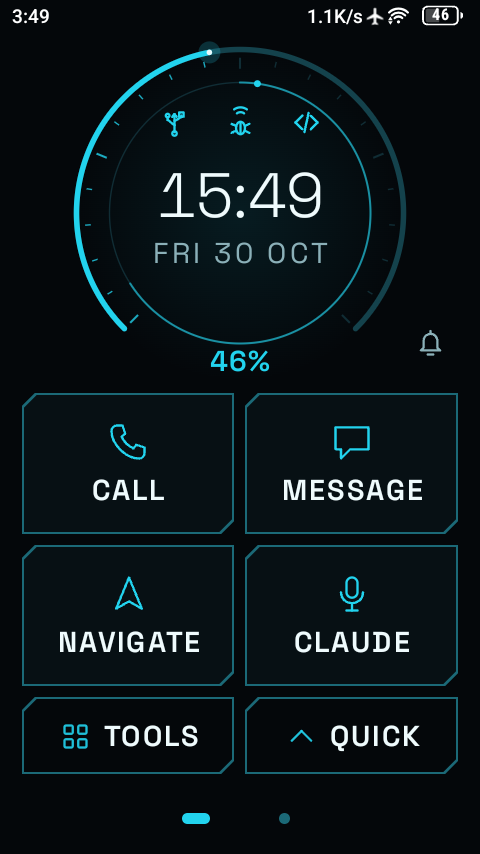
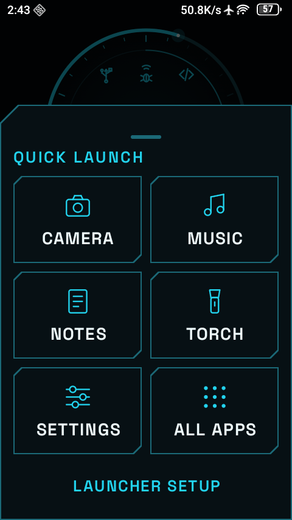
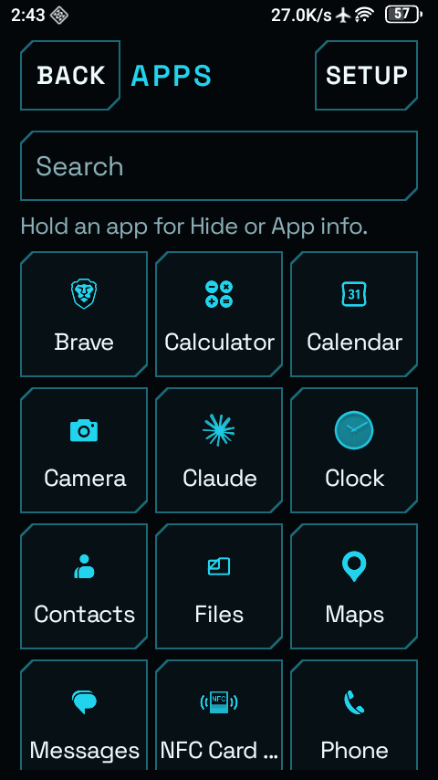
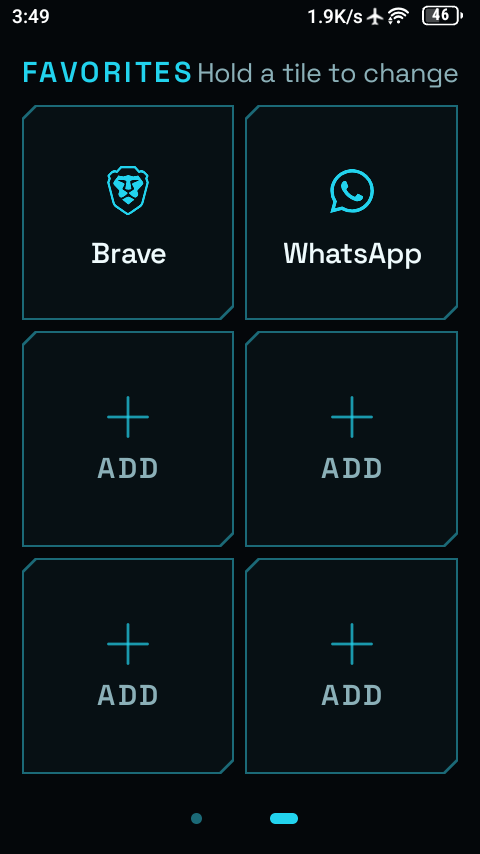
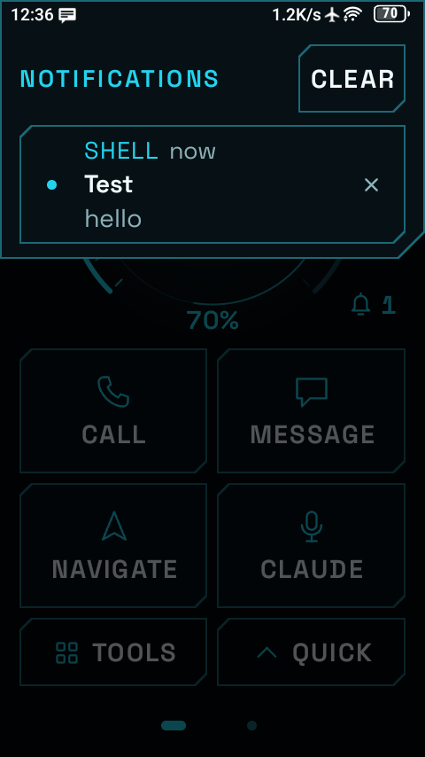
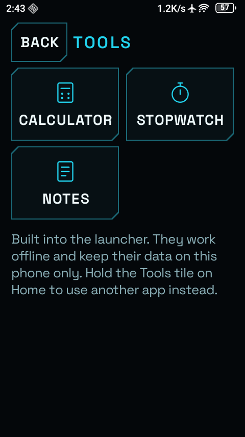
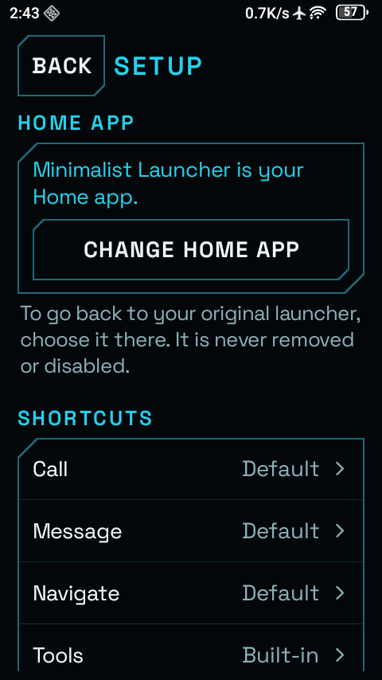
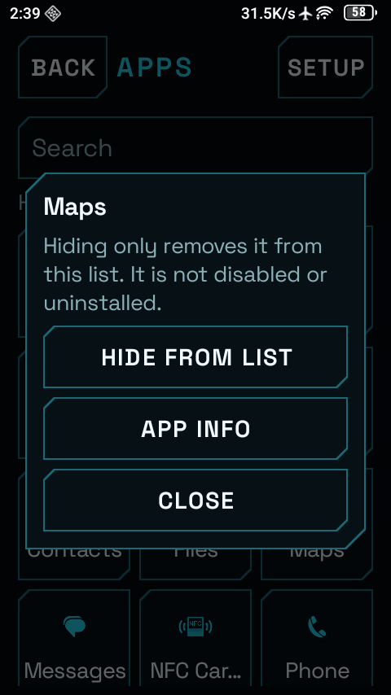

<h1 align="center">Minimalist Launcher</h1>

<p align="center">
  A calm, near-black home screen for Android.<br>
  One big clock, four big buttons, and nothing else asking for your attention.
</p>

<p align="center">
  
</p>

<p align="center">
  <b>No ads &middot; No accounts &middot; No tracking &middot; No internet permission</b>
</p>

---

## What is it?

Minimalist Launcher replaces your phone's **home screen**, the screen you see when you press Home. It is built for the
Unihertz Jelly Star, a very small phone, and it trades busy icon grids for a handful of large, easy-to-hit buttons.

It is a normal Android app. Your original launcher stays installed, so you can switch back at any time. It needs no root
and changes nothing deep inside your phone.

## A quick look

<table>
  <tr>
    <td align="center"><br><b>Home</b><br><sub>Clock, battery ring, four buttons</sub></td>
    <td align="center"><br><b>Quick launch</b><br><sub>Swipe up for the essentials</sub></td>
    <td align="center"><br><b>All apps</b><br><sub>A tidy three-column grid</sub></td>
    <td align="center"><br><b>Favorites</b><br><sub>Swipe left for six more</sub></td>
  </tr>
  <tr>
    <td align="center"><br><b>Notifications</b><br><sub>Tap the bell (opt-in)</sub></td>
    <td align="center"><br><b>Tools</b><br><sub>Calculator, stopwatch, notes</sub></td>
    <td align="center"><br><b>Setup</b><br><sub>Everything in one place</sub></td>
    <td align="center"><br><b>Hide an app</b><br><sub>Hold an app in the list</sub></td>
  </tr>
</table>

## What you can do

**On the home screen**
- **See the time and battery at a glance.** The ring around the clock is your battery. The whole screen turns yellow at
  40% and red at 15%, so you notice before it is too late. A small "+" and a gentle animation show while charging.
- **Tap a big button.** Call, Message, Navigate and Claude open the apps you choose (or your phone's defaults).
  Hold a button to pick a different app for it.
- **Talk to Claude.** Hold the Claude button, speak, and let go. The button fills up while you hold it.
- **Swipe up** (or tap **Quick**) for Camera, Music, Notes, Torch, Settings and All apps.
- **Swipe left** for a second page with six favorite apps of your own.
- **Spot developer switches.** Small USB, wireless-debugging and developer-options icons appear above the clock only
  while those are switched on. Tap one to jump straight to its switch.

**Everywhere else**
- **All apps** is a searchable three-column grid. Hold an app to hide it from the list or open its info. Hiding does not
  uninstall anything.
- **Notifications** appear in a tidy sheet when you tap the bell. Dismiss one, clear all, or tap to open. The sheet closes
  itself when everything is cleared.
- **Tools** are built in and work offline: a calculator, a stopwatch and notes with text and voice memos.
- **Setup** holds every option: accent colour (five to choose from), 12/24-hour clock, reduced motion, haptics,
  shortcuts and favorites.
- **A live wallpaper** gives your lock screen the same look. It is a still image and does not animate or drain battery.
- Everything scales with your system text size.
- There is one small hidden surprise on the clock. Try holding it.

## Privacy, in plain words

- **No internet.** The app does not have the internet permission, so it cannot send anything anywhere, even by accident.
- **No accounts, ads or analytics.** Nothing to sign in to, nothing collecting data.
- **Your data stays on the phone.** Notes and voice memos live in the app's private storage and are not backed up.
- **Notifications are opt-in.** Nothing is read until you switch on notification access yourself in Android's settings.
  Notifications are held in memory only and never saved.
- **Two small permissions.** Microphone (only for voice memos, and Android asks first) and vibration (for haptic feedback).

Details are in [PRIVACY_CHECKLIST.md](PRIVACY_CHECKLIST.md). What has and has not been tested is in
[VERIFICATION.md](VERIFICATION.md).

## Install

You need a computer with [adb](https://developer.android.com/tools/adb) and the phone connected (USB or Wi-Fi), or you can
copy the APK file to the phone and open it (allow "install unknown apps" for your file manager).

```sh
git clone https://github.com/csngh/minimalist-tinyphone-launcher.git
cd minimalist-tinyphone-launcher
./gradlew assembleDebug
adb install -r app/build/outputs/apk/debug/app-debug.apk
```

Building needs JDK 17 and the Android SDK (platform 35). The first build downloads Gradle and AndroidX; the app itself
never goes online. Run the tests with `./gradlew testDebugUnitTest lintDebug`.

## Make it your home screen

1. Open **Minimalist Launcher** from your app list.
2. Tap **Set as Home app**. Android shows its own confirmation. Pick Minimalist Launcher.
3. If the dialog does not appear, go to Setup and tap **Change Home app**
   (or Android Settings > Apps > Default apps > Home app).

## Going back to your old launcher

Your original launcher is never removed or disabled. Any one of these works:

1. In Minimalist Launcher: Quick > Launcher setup > **Change Home app**, then choose the original.
2. Android Settings > Apps > Default apps > Home app.
3. Uninstall Minimalist Launcher. Android falls back to the launcher that is left.
4. From a computer: `adb uninstall com.minimalist.launcher`.

## Good to know

- **Tested on** a Unihertz Jelly Star running Android 16 (480 x 854). It should work on Android 10 or newer, but other
  phones have not been tried.
- **It changes the home screen and its own screens only.** The lock screen, Android's notification shade and system
  settings stay as they are, and it does not remove the phone maker's own telemetry.
- **No alarms or timers.** A reliable alarm would need permissions this app deliberately does not ask for.
- **Sideloaded installs** may need one extra step for notifications: App info > three dots > **Allow restricted
  settings**, then turn on notification access.

## For developers

Kotlin and Jetpack Compose, one module, minSdk 29. Source is in `app/src/main/java/com/minimalist/launcher/`.

| File | What it does |
| --- | --- |
| `MainActivity.kt` | Asks for the Home role and handles the Home intent |
| `LauncherViewModel.kt` | Screen state, app list, role and notification-access state |
| `NotificationHub.kt` | The opt-in notification listener and its in-memory store |
| `PocketWallpaperService.kt` | The still live wallpaper |
| `Calculator.kt`, `Notes.kt` | Built-in tools' logic (unit-tested) |
| `Prefs.kt`, `Apps.kt`, `Format.kt` | Settings, app discovery and launching, clock formatting |
| `IconMask.kt` | Turns any app icon into a single-colour glyph (cached) |
| `EggSound.kt` | Synthesised sound for the hidden surprise |
| `ui/` | Compose screens, tiles, glyphs and shared components |

## Credits

Type: Space Grotesk &copy; The Space Grotesk Project Authors, SIL Open Font License 1.1
([FONT_LICENSE_OFL.txt](FONT_LICENSE_OFL.txt)), bundled in `res/font`.
